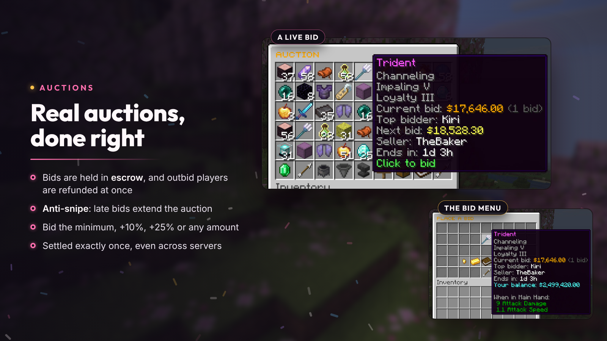
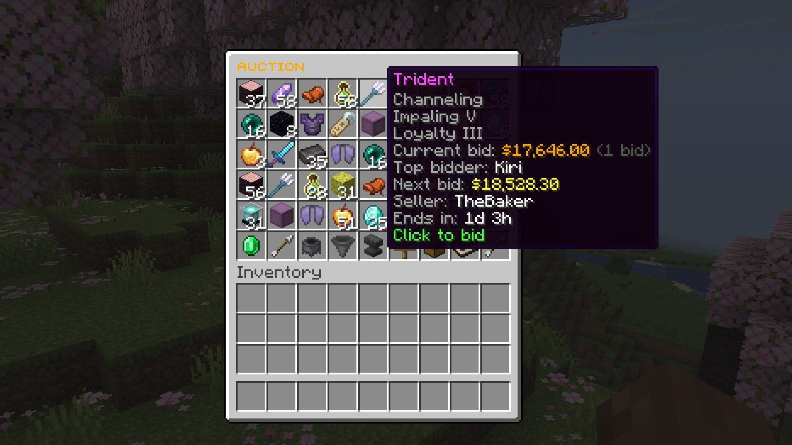
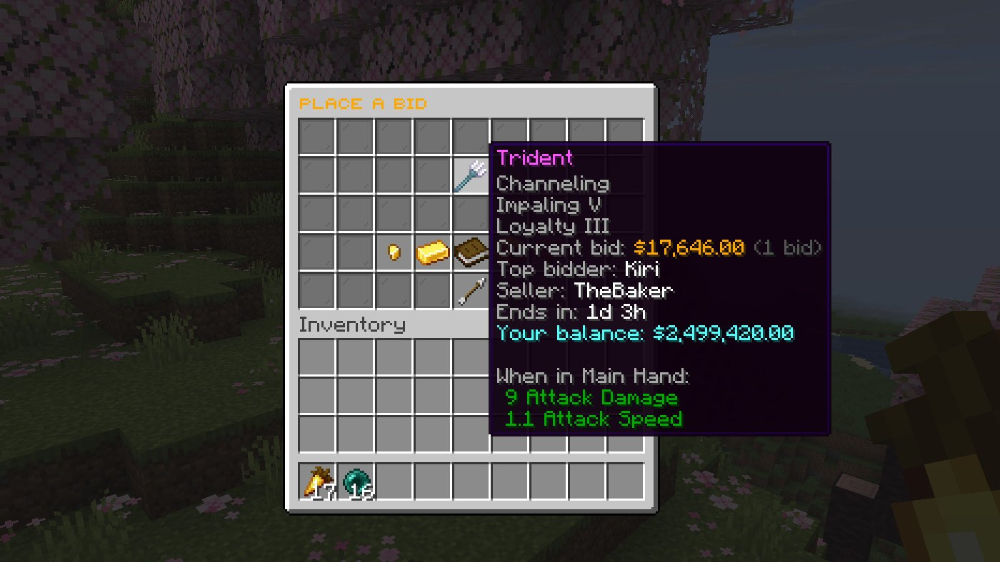
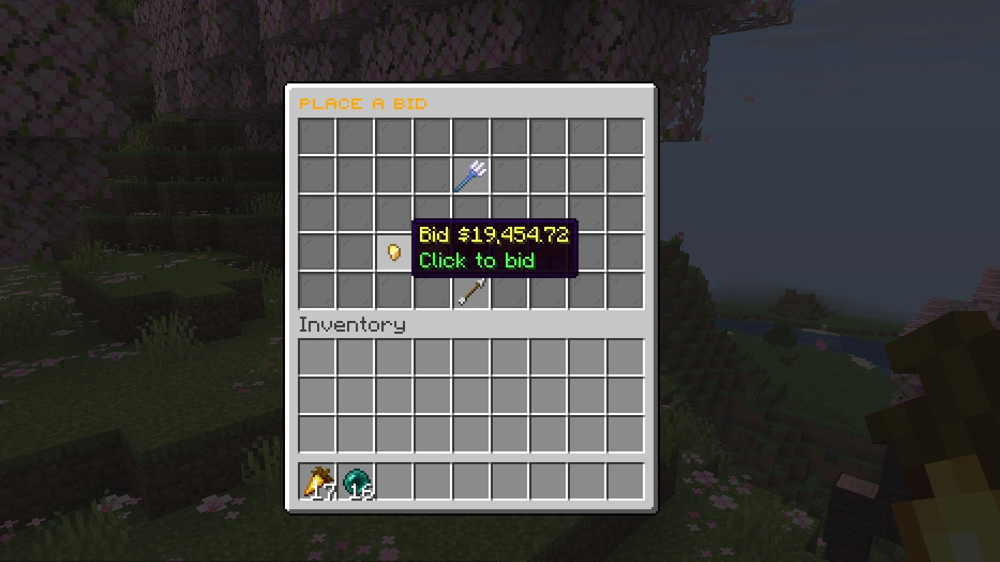

# Auctions and bids

Next to Buy It Now, sellers can run real auctions: players bid, the highest bidder wins when time runs out, and every bid is held safely until then.

## Starting an auction

- `/ah auction <starting bid>`, or switch the sell menu to **Auction**.
- Needs `donutauction.sell.auction` (`bidding.permission`; leave it empty to let everyone).
- Turn auctions off entirely with `bidding.enabled: false`.

## Bidding

Click an auction listing to open the bid menu. It offers the minimum next bid, +10%, +25% or an amount you type:

A new bid must beat the current one by `bidding.min-increment-percent` (5%) or `bidding.min-increment` (1), whichever is higher.

## Escrow and refunds

The bid is taken from your balance when you place it. If someone outbids you, it's refunded instantly and you're told (`notifications.outbid`).

## Anti-snipe

A bid in the final `bidding.anti-snipe-seconds` (30) extends the auction to that many seconds, so nobody wins by bidding at the last moment.

## When it ends

The highest bidder wins and the seller is paid, minus any [sales tax](economy-and-rules.md#sales-tax). This happens exactly once, even with several servers sharing MySQL, and an interrupted payout is completed on the next start.

The winner gets the item straight away if they're online and it fits; otherwise it waits in [`/ah collect`](collection-and-history.md).
