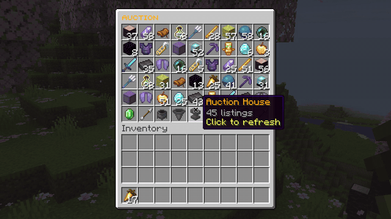
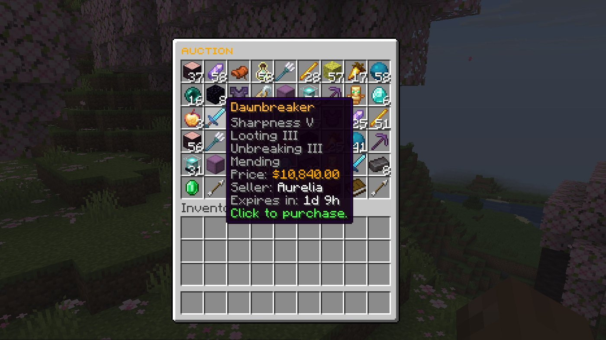
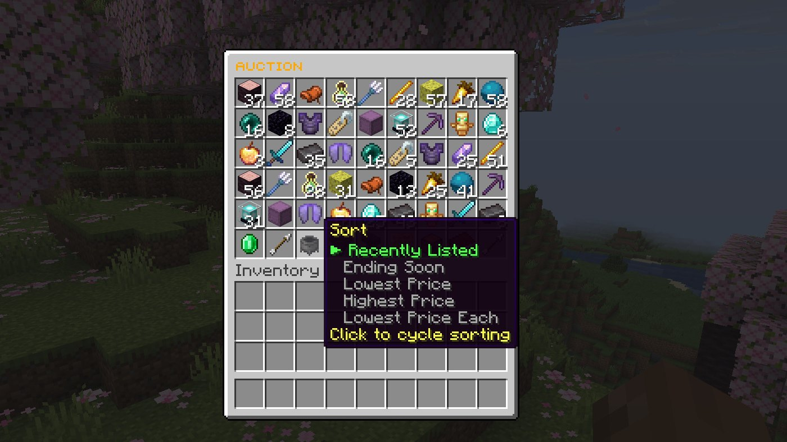
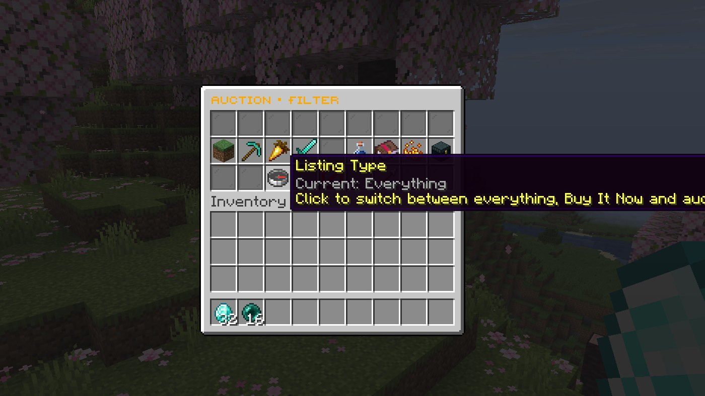
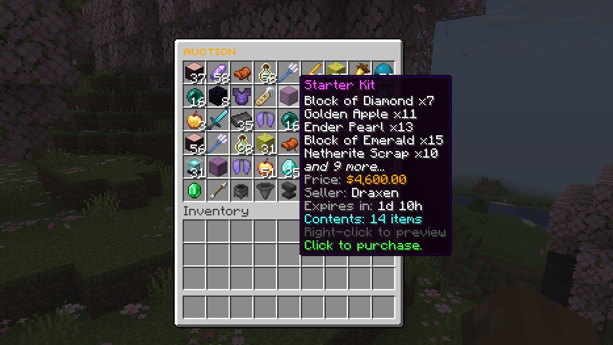
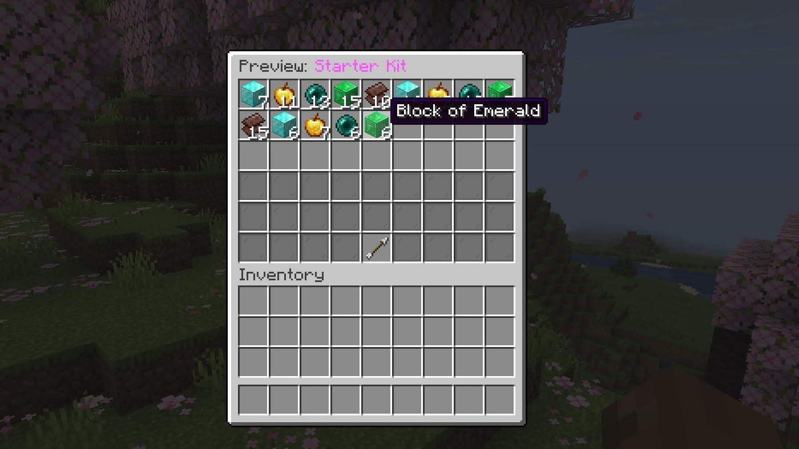
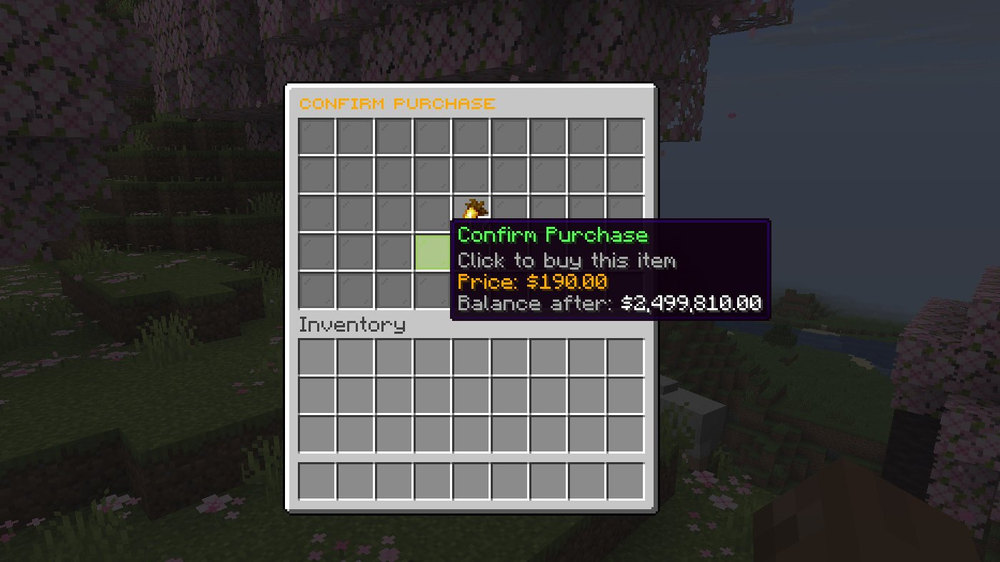

# Browsing and buying

`/ah` (or `/auction`) opens a 45-slot market. Hover any listing to see its price, seller and time left, and click to buy.

## The market

- **Search** with `/ah search <text>` or the search button: item names, lore, enchantments (`sharpness`), seller names and the contents of shulker boxes. Every word must match.
- **One seller's shop** with `/ah view <player>`, or just `/ah <player>`.
- Item names are shown in each player's own language.

## Sorting

Click the sort button to cycle through **Recently Listed**, **Ending Soon**, **Lowest Price**, **Highest Price** and **Lowest Price Each**. Stacks show their price per item, so a stack of 64 can be compared with a single item.

## Filters

Filter by category (blocks, tools, food, combat, potions, books, ingredients, utilities) and by listing type: everything, Buy It Now only or auctions only.

## Shulker boxes

Shulker box listings list their contents in the tooltip. **Right-click** to open a full preview before you buy:

Turn this off with `shulker-support.preview-contents: false`.

## Buying

Clicking a Buy It Now listing opens a confirmation with the price and your balance after paying. The item goes into your inventory if the whole stack fits; otherwise it waits safely in your [collection](collection-and-history.md).

**Fast buy:** `/ah fastbuy` toggles skipping the confirmation (permission `donutauction.fastbuy`, configured under `fast-buy`).

Auction listings work differently: clicking one opens the bid menu. See [Auctions and bids](auctions.md).
