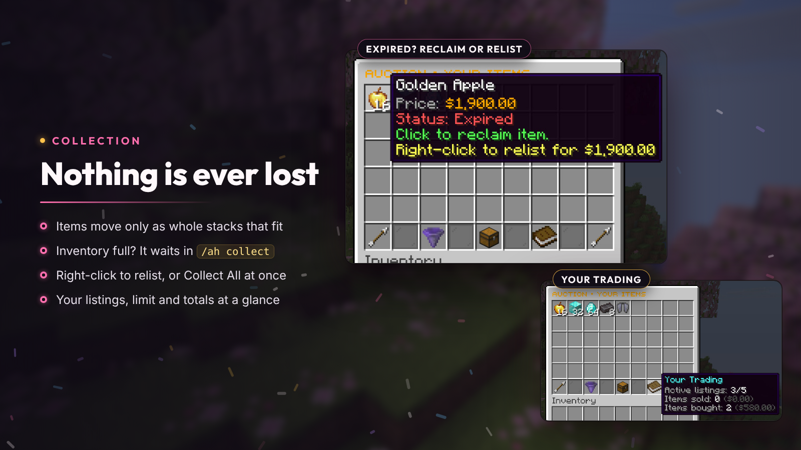
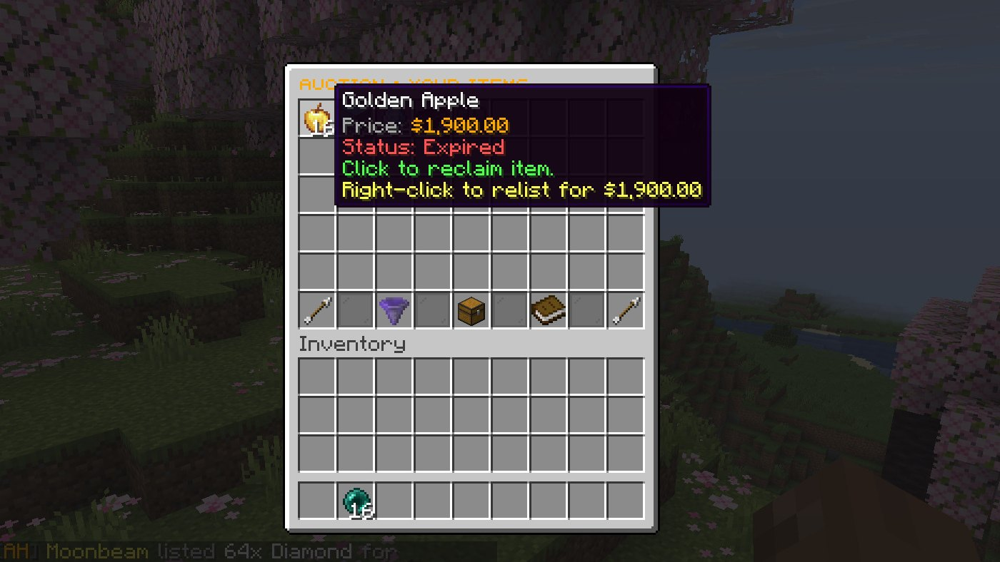
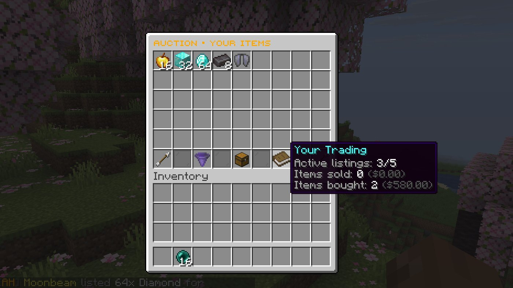
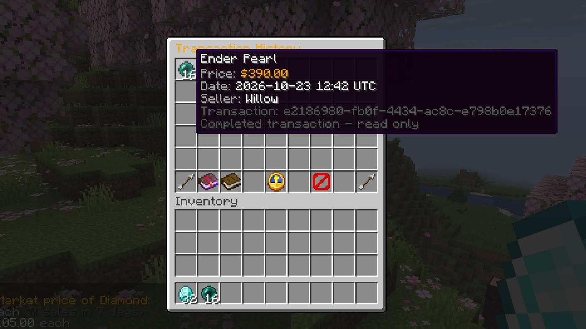

# Collection and history

Nothing is ever dropped or lost. Items are handed over only as whole stacks that fit; everything else waits in your collection until you take it.

## Your Items (`/ah collect`)

`/ah collect` (or `/ah cancel`) shows your active listings and everything waiting for you:

- purchases made with a full inventory,
- auctions you won while offline or without room,
- your expired listings,
- listings staff removed.

**Left-click** an item to take it back, **right-click** an expired listing to relist it at the same price, or use **Collect All** to take everything that fits. Waiting items are also delivered when you join if they fit (`collection.deliver-on-join`).

## Transaction history

Click the book at the bottom of the market, or run `/ah history` (`/ah history sold` for your sales):

- **Bought** and **Sold** tabs show only your own completed trades, with the item, exact price, tax, date and the other player.
- Everything in the history menu is read-only.
- Dates are in `history.timezone` (UTC by default) using `history.date-format`.
- `history.retention-days` deletes old settled history (0, the default, keeps everything). Staff can also run `/ah admin purge <days>`.

## Compact prices

By default prices use your economy plugin's formatting. Set `price-display.compact.enabled: true` to show browse and Your Items prices as `1.5k` or `2.3M`:

| Key | Meaning |
| --- | --- |
| `precision` | Decimal places, 0–6 |
| `thousand-suffix`, `million-suffix` | `k` and `M` by default |
| `locale` | BCP 47 locale, `en-US` by default |
| `template` | `%amount%`, `%suffix%` and `%currency%` (the economy's currency name) |

Amounts under 1,000 keep the economy's formatting. This is display only: listing, charging and stored prices keep their exact values, and confirmations show the exact amount.
