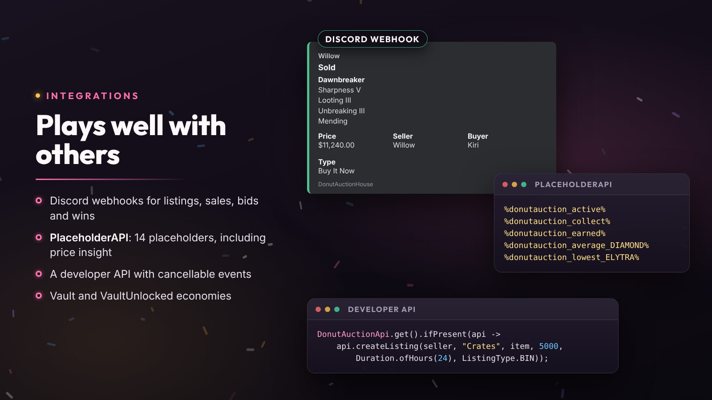

# Developer API

Read the market, create listings from your own plugin (crates, NPC shops, quest rewards) and react to every listing, purchase and bid with Bukkit events.



## Setup

Add DonutAuctionHouse as a soft dependency in your `plugin.yml`, so it enables first:

```yaml
softdepend: [DonutAuctionHouse]
```

Then get the API once it has enabled:

```java
import io.nightbeam.donutauction.api.DonutAuctionApi;

DonutAuctionApi.get().ifPresent(api -> {
    api.activeListings();                                   // what is for sale
    api.marketStats(Material.DIAMOND).thenAccept(stats -> { /* average price each, sales */ });
    api.createListing(sellerId, "Crates", item, 5000, Duration.ofHours(24), ListingType.BIN);
});
```

`get()` returns an empty `Optional` when the plugin isn't installed or enabled.

## Methods

| Method | Returns |
| --- | --- |
| `activeListings()` | Every listing for sale |
| `listingsOf(UUID seller)` | One seller's active listings |
| `listing(UUID auctionId)` | One listing, if it exists |
| `marketStats(Material)` | `CompletableFuture<MarketStats>`: recent average price each and sales |
| `playerStats(UUID)` | `CompletableFuture<PlayerStats>`: sold, earned, bought, spent |
| `createListing(seller, sellerName, item, price, duration, type)` | `CompletableFuture<AuctionListing>` |
| `openAuctionHouse(Player)` | Opens the market for a player |
| `formatPrice(double)` | A price formatted the way the plugin shows it |

Listings are immutable snapshots: don't modify their `item()`.

`createListing` lists on behalf of a player or the server. No fees, limits or blacklist apply, and the item must already be out of any inventory: you hand it over. The future completes exceptionally if the listing couldn't be saved.

## Events

All in `io.nightbeam.donutauction.api.event`; each one carries the `AuctionListing` (`getListing()`).

| Event | When | Notes |
| --- | --- | --- |
| `AuctionPreListEvent` | Before a player lists | Cancellable; seller, item, price, type, duration; `setCancelMessage(...)` |
| `AuctionPrePurchaseEvent` | Before a purchase | Cancellable; buyer; `setCancelMessage(...)` |
| `AuctionPreBidEvent` | Before a bid | Cancellable; bidder, amount; `setCancelMessage(...)` |
| `AuctionListedEvent` | A listing was created | Asynchronous |
| `AuctionPurchasedEvent` | A Buy It Now listing sold | Asynchronous; buyer, price, tax |
| `AuctionBidEvent` | A bid was placed | Asynchronous; bidder, amount, previous bidder |
| `AuctionWonEvent` | An auction ended with a winner | Asynchronous; winner, price, tax |
| `AuctionEndedEvent` | A listing ended | Asynchronous |
| `AuctionCancelledEvent` | A listing was cancelled or removed | Asynchronous; `isByAdmin()`, actor |

The asynchronous events fire off the main thread: schedule any world or inventory changes back onto the right thread (the region thread on Folia).
