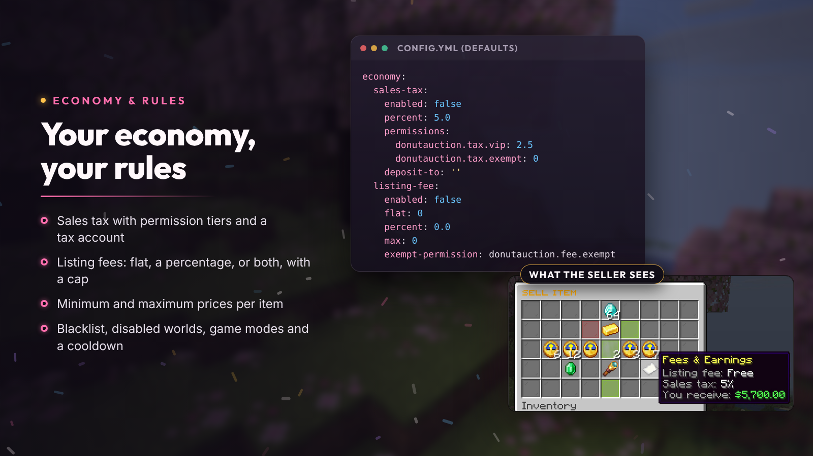

# Economy and rules

Sales tax, listing fees, price limits, listing limits and what can be sold. Tax and fees are off until you turn them on, and every rule has a bypass permission for staff.



## Sales tax

```yaml
economy:
  sales-tax:
    enabled: true
    percent: 5.0
    permissions:
      donutauction.tax.vip: 2.5
      donutauction.tax.exempt: 0
    deposit-to: ''
```

Taken from the seller's proceeds when an item sells. Players with a tier permission pay that tier's rate; the lowest matching tier applies. `deposit-to` sends the tax to a player name or UUID (a server bank account); empty removes it from the economy.

## Listing fees

```yaml
economy:
  listing-fee:
    enabled: true
    flat: 100
    percent: 1.0
    max: 5000
    exempt-permission: donutauction.fee.exempt
```

Paid by the seller when listing and not refunded. `max` caps the fee (0 = no cap). The sell menu shows the fee and tax before you confirm.

## Prices

| Key | Meaning |
| --- | --- |
| `auction.min-price`, `auction.max-price` | Limits for a whole listing |
| `auction.price-limits` | Per single item, for example `DIAMOND: {min: 50, max: 100000}` (a stack of 64 may cost 64 times as much) |
| `auction.allow-shorthand-prices` | Accept `1k`, `2.5m`, `3b`, `1t` |

## Listing limits

`auction-limits` sets how many listings a player can have: `default-limit` (5), raised by permissions such as `donutauction.limit.25` or `donutauction.limit.unlimited`. `auction-slots` adds extra slots on top with `donutauction.slots.<n>`. `/ah limit` shows a player's own limit.

## What can't be sold

```yaml
blacklist:
  materials: [BEDROCK, BARRIER, COMMAND_BLOCK, ...]
  name-contains: []        # e.g. "Soulbound"
  lore-contains: []
  custom-model-data: []
  pdc-keys: []             # e.g. "myplugin:soulbound"
```

Bypass: `donutauction.blacklist.bypass`.

## Where and when

| Key | Meaning | Bypass |
| --- | --- | --- |
| `restrictions.disabled-worlds` | Worlds where players can't list | `donutauction.restrictions.bypass` |
| `restrictions.blocked-gamemodes` | Game modes that can't list (creative and spectator by default) | `donutauction.restrictions.bypass` |
| `auction.cooldown-seconds` | Wait between two listings (0 = off) | `donutauction.cooldown.bypass` |
