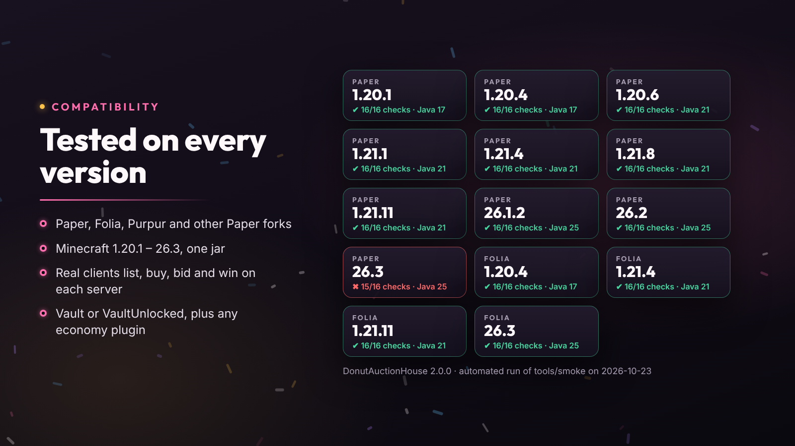

# Installation

DonutAuctionHouse is one jar for every supported version. Install it on the server only: players don't need any mods.

## Requirements

| Server | Minecraft | Java | Notes |
| --- | --- | --- | --- |
| Paper, Purpur, other Paper forks | 1.20.1 – 1.20.4 | 17+ | |
| Paper, Purpur, other Paper forks | 1.20.5 – 1.21.11 | 21+ | |
| Paper, Purpur, other Paper forks | 26.1 – 26.3 | 25+ | |
| Folia | 1.20.4 – 26.3 | as above | Region-thread safe |
| Spigot, Bukkit | | | Not supported: they lack Paper's API. The plugin says so and disables itself. |

- **Vault** or **VaultUnlocked**, plus an economy plugin that registers Vault's Economy service (EssentialsX, CMI and others).
- Optional: [PlaceholderAPI](placeholders.md), DonutCore (display names), and MySQL plus Redis to [share one market between servers](multi-server.md).

Each release runs an automated matrix on real Paper 1.20.1, 1.20.4, 1.20.6, 1.21.1, 1.21.4, 1.21.8, 1.21.11, 26.1.2, 26.2 and 26.3 servers and Folia 1.20.4, 1.21.4, 1.21.11 and 26.3, with real clients listing, buying, bidding and winning.

## Install

1. Put `DonutAuctionHouse-<version>.jar` in `plugins/`.
2. Install Vault or VaultUnlocked and your economy plugin.
3. Restart the server.
4. Edit `plugins/DonutAuctionHouse/config.yml` and `messages.yml`, then run `/ah reload`.

The plugin starts with SQLite (`auctions.db` in its folder); nothing else needs setting up for a single server.

## Updating

Replace the jar and restart. Listings, history, config values and messages are kept, and new settings are added to `config.yml` automatically. Back up your database first, as with any update.

**From 1.x:** the same steps apply. The 1.x `donutcore.auction.*` permissions keep working. See the [changelog](../CHANGELOG.md) for what changed.

## Downloads

- [CurseForge](https://www.curseforge.com/minecraft/bukkit-plugins/donut-auction)
- [Modrinth](https://modrinth.com/project/8XgyeSRH)
- [GitHub](https://github.com/MeherBenSalem/DonutAuction)
