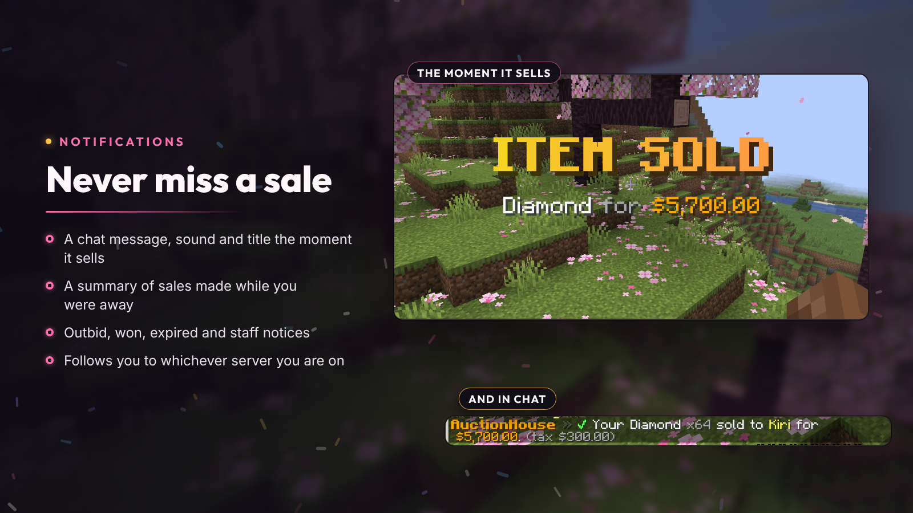
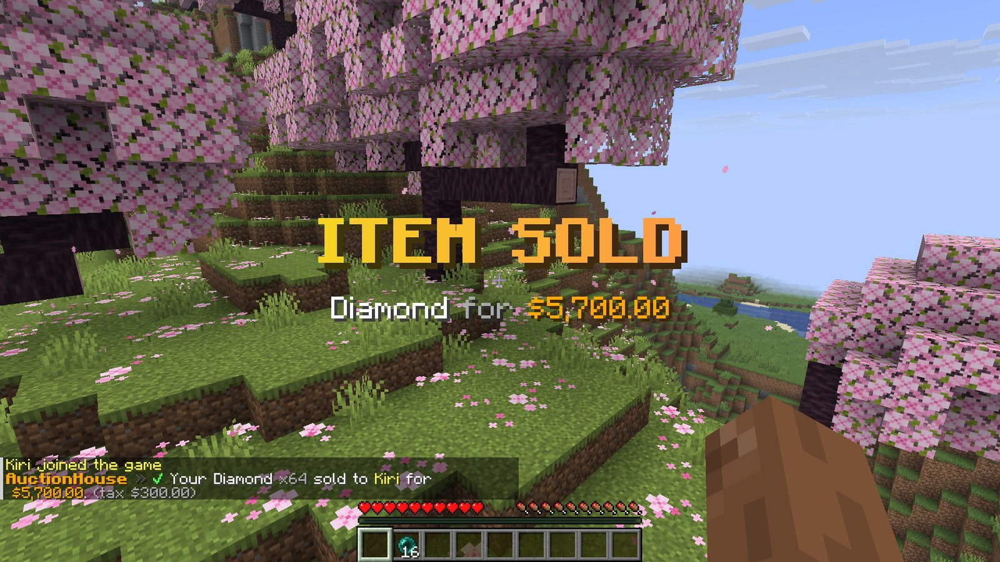
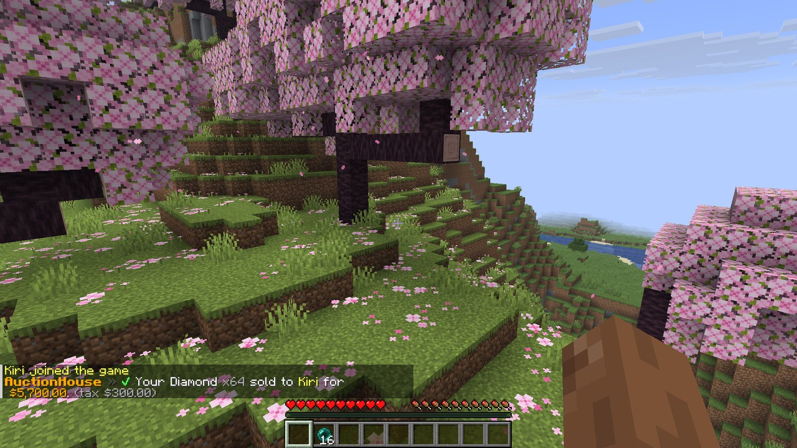

# Notifications

Sellers hear about a sale the moment it happens, on whichever server they're on, or get a summary when they next join.

## When your item sells

An **ITEM SOLD** title, a sound and a chat message with the buyer, price and tax:

## Every notification

| Key under `notifications` | When |
| --- | --- |
| `sold` | One of your items sold (`titles` adds the on-screen title) |
| `outbid` | Someone outbid you; your bid has been refunded |
| `won` | You won an auction |
| `expired` | One of your listings expired and is in your collection |
| `bids-on-my-items` | Someone bid on your auction |
| `join-summary` | On join, a summary of sales made while you were offline, with the total earned (after `join-delay-seconds`) |

Players are also told when staff remove one of their listings. All the texts are in [`messages.yml`](../src/main/resources/messages.yml) under `notify`.

## Sounds

Each event has a sound under `sounds` (`namespace:path`, optionally `:volume:pitch`). Use `none` to mute one, or `sounds.enabled: false` to mute them all.

## New-listing broadcasts

Set `broadcast.new-listings: true` to announce new listings in chat to players with `donutauction.broadcast.receive`, for listings at or above `broadcast.min-price` and at most once every `broadcast.cooldown-seconds`.

## Discord

Sales, listings, bids, wins and expiries can also be posted to a Discord channel. See [Integrations](integrations.md#discord-webhooks).
