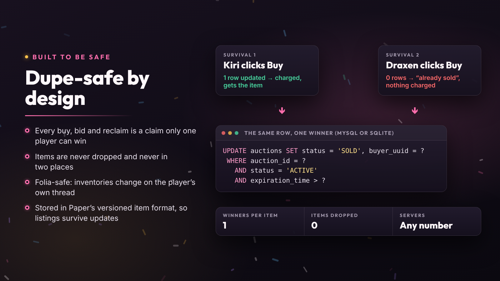

# How items stay safe

DonutAuctionHouse is built so an item can't be duplicated or lost: by double clicks, lag, crashes or two servers acting at once.

## One winner per action

Buying, bidding, ending an auction, cancelling, reclaiming and collecting each start with a conditional database update that only one player on one server can win. Whoever loses that race is told the listing is gone, and nothing moves for them.

## The item is always somewhere

An item is in a hand, in a pending sale, on the market or in a collection. It's never in two places, and never dropped on the ground: items are only handed over as whole stacks that fit, and everything else waits in [`/ah collect`](collection-and-history.md).

## Crashes and restarts

An auction is settled exactly once. If the server stops in the middle of a payout, the payout is completed on the next start.

## Folia

Inventories only change on the player's own region thread.

## Minecraft upgrades

Items are stored in Paper's versioned format and run through Mojang's data fixers, so listings survive Minecraft updates. An item that can't be read is set aside and reported (`/ah admin info`); it never blocks the rest of the market.

## Text from players

Item names and other player-made text are always inserted as plain text, so they can't add colors or click events to messages.

## Reporting a problem

If you ever find a way to duplicate or lose items, please report it privately as described in [SECURITY.md](../.github/SECURITY.md) rather than in a public issue.
