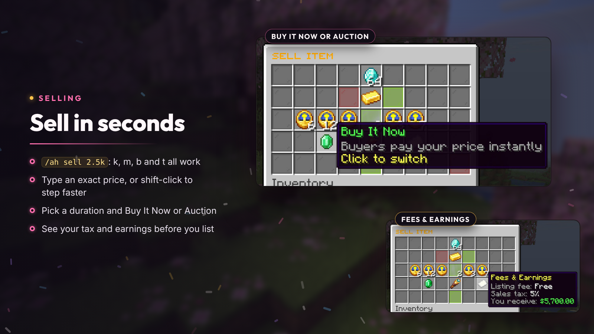
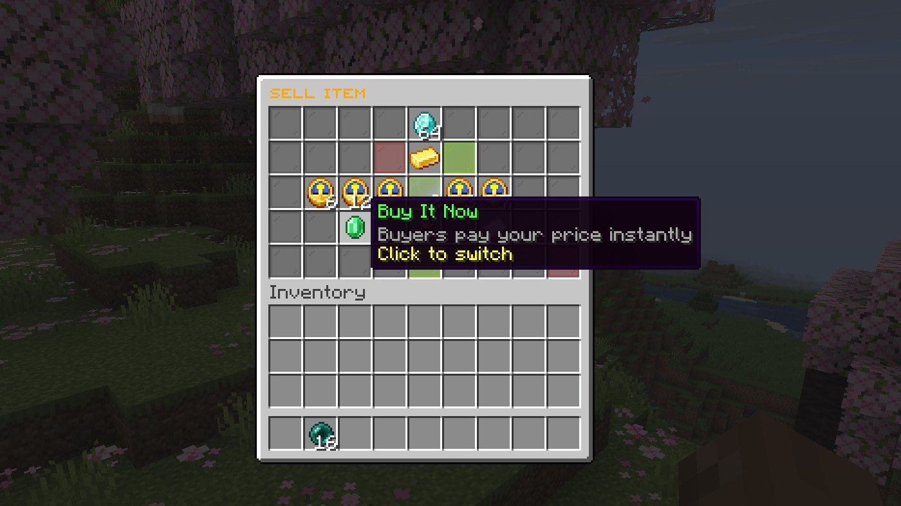
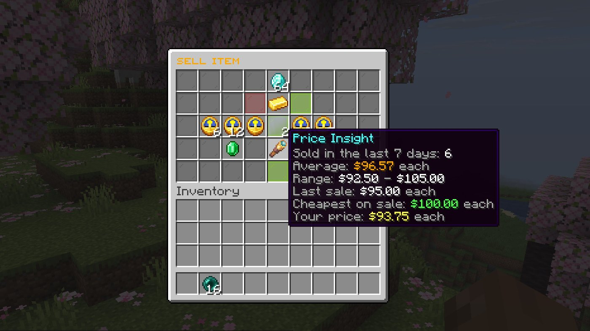
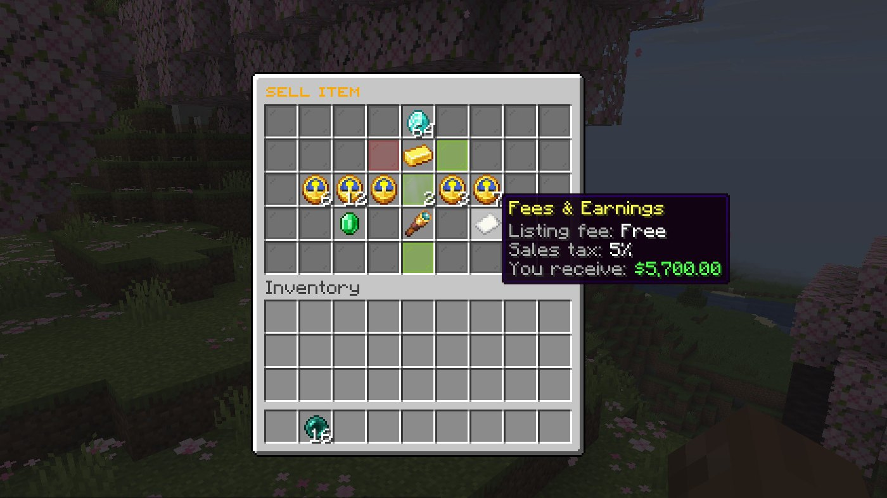
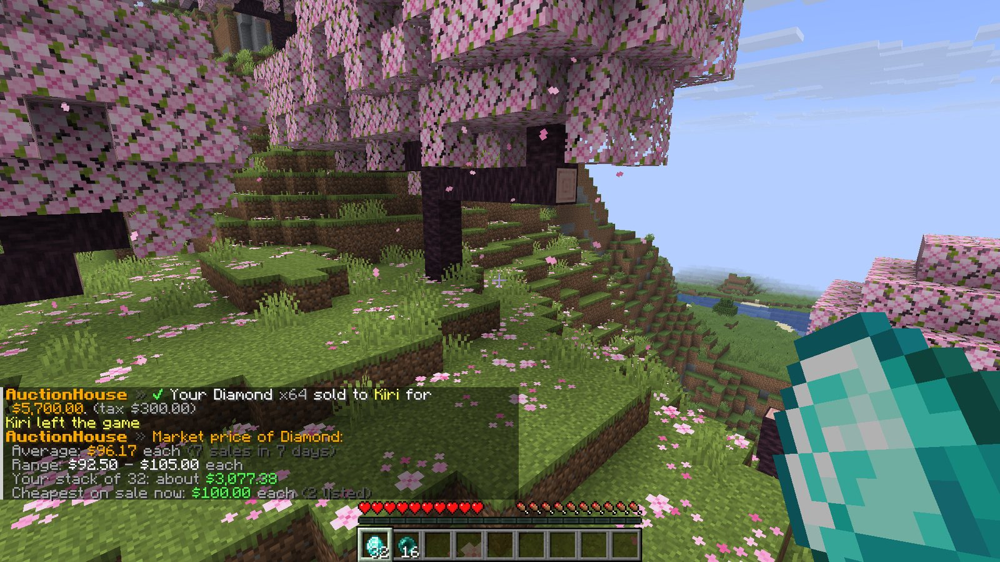

# Selling

Hold the item and run `/ah sell <price>`, or open the sell menu to pick a price, duration and listing type with your fees shown before you list.



## Quick sell

```
/ah sell 2500
/ah sell 2.5k
/ah sell 1.2m auction
```

`k`, `m`, `b` and `t` shorthand and `1,250` style numbers work (`auction.allow-shorthand-prices`). Add `auction` to start an [auction with bids](auctions.md) instead of Buy It Now.

## The sell menu

1. Run `/ah sell <price>`: the menu opens with your price. Click the price to type an exact amount, or use the +/- buttons (shift-click for bigger steps).
2. Pick a **duration**: the lengths in `auction.durations` (6 hours to a week by default, up to `auction.max-duration-hours`).
3. Pick **Buy It Now** or **Auction**.
4. Check **Price Insight** and **Fees & Earnings**, then confirm.







## What it's worth

`/ah price` shows the recent prices of whatever you're holding, including what your whole stack is worth:



Price insight covers the last `market.window-days` days (7 by default): average, range and last sale price per item, and the cheapest one on sale now. The same figures are available as [placeholders](placeholders.md).

## Fast sell

`/ah fastsell` toggles listing straight away, without the menu, using your last duration (permission `donutauction.fastsell`, configured under `fast-sell`).

## Limits and rules

- Each player has a listing limit (5 by default, more with `donutauction.limit.<n>`); `/ah limit` shows yours.
- Prices must be between `auction.min-price` and `auction.max-price`, and within any per-item `auction.price-limits`.
- Some items can't be listed at all, and listing can be blocked in some worlds and game modes.

See [Economy and rules](economy-and-rules.md) for all of them.
