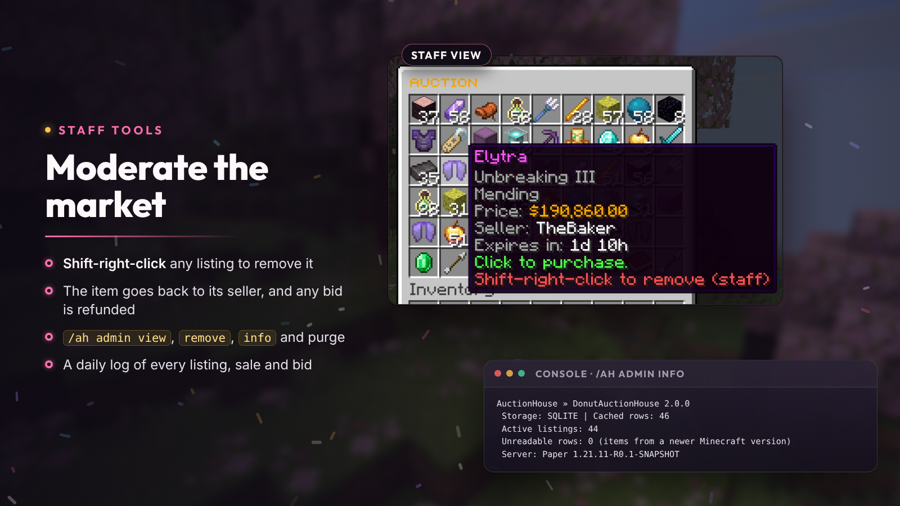
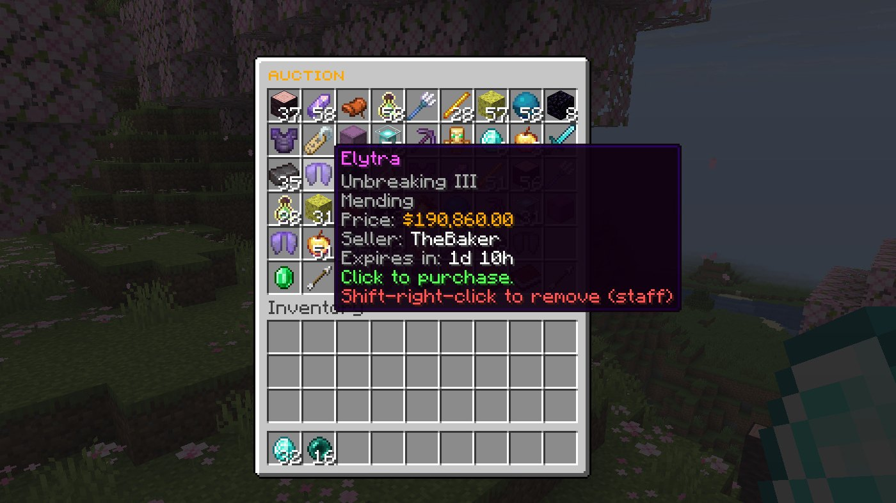
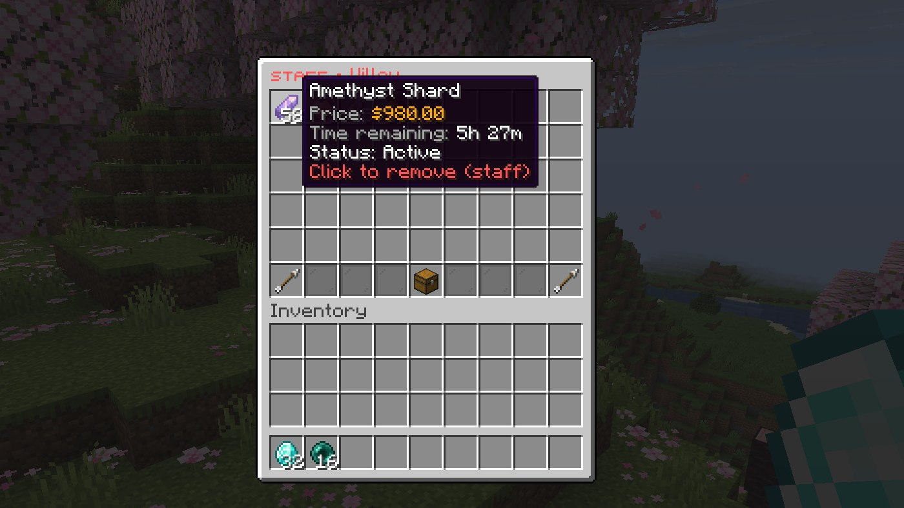

# Staff tools

Remove listings, inspect a player's shop, check the database and clean up old history. Everything needs `donutauction.admin`.

## Remove a listing

Staff see a remove hint on every listing. **Shift-right-click** to remove it:

The item goes back to the seller's [collection](collection-and-history.md), any held bid is refunded, and the seller is told.

## Commands

| Command | What it does |
| --- | --- |
| `/ah admin view <player>` | A player's listings; click one to remove it |
| `/ah admin remove <id>` | Remove a listing by id |
| `/ah admin info` | Storage type, active listings and unreadable rows |
| `/ah admin purge <days>` | Delete settled history older than this many days |
| `/ah reload` | Reload `config.yml` and `messages.yml` |

## Open menus for players

`/ah open <player> [browse|items|history|search <text>]` opens a menu for a player. It works from the console, NPC plugins and menu plugins, and needs `donutauction.admin.open`.

## Transaction log

With `transaction-log.enabled` (the default), every listing, sale, bid, win, cancel and reclaim is written to `plugins/DonutAuctionHouse/logs/transactions-YYYY-MM-DD.log`, one line per trade (UTC).
